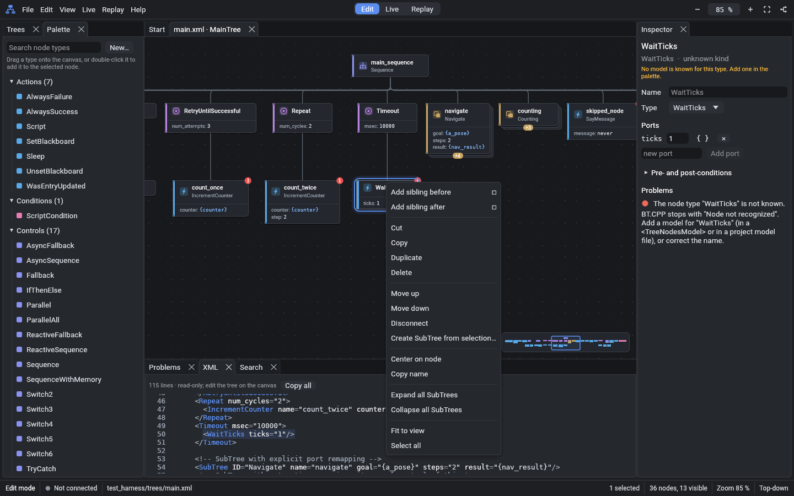

# FastTick

FastTick is a fast tree editor and debugger for
[BehaviorTree.CPP](https://github.com/BehaviorTree/BehaviorTree.CPP) v4.
It is a desktop application. Use it to write behavior trees, to debug a running
executor, and to replay log files. All features are free.

Status: version 0.1.0. See the [user guide](docs/USER_GUIDE.md) and the
demo notes [M1](docs/demo/M1.md), [M2](docs/demo/M2.md),
[M3](docs/demo/M3.md) and [M4](docs/demo/M4.md).

## Features

- Edit BT.CPP v4 XML files (`BTCPP_format="4"`) without loss of data:
  comments, attribute order and white space stay.
- Projects with more than one XML file (`.ftproj`). FastTick finds the
  files in the same folder that have the missing SubTrees and node models.
- A tree editor: drag and drop, copy and paste, undo and redo, automatic
  layout, an inspector for ports and conditions, SubTree tools, a palette
  with node models, validation with the rules of BT.CPP, an XML panel and
  search.
- Import of custom node models from `BT::writeTreeNodesModelXML`.
- Live debugging of an executor that runs the BT.CPP publisher: live
  status, blackboards, breakpoints, forced results and recording.
- Replay of `.btlog` files (`BT::FileLogger2`) and SQLite logs
  (`BT::SqliteLogger`): timeline, transitions table, statistics, JSON and CSV
  export.
- Fast authoring: drag from the dot under a node, or push Shift+A, and
  find the node type with fuzzy search. Fold large subtrees. Find the
  nodes that use a blackboard key.
- Open, edit and save the files of a robot over SSH (File > Open from
  robot). FastTick uses the `ssh` program of the system and warns if a file
  changed on the robot. A command can restart the robot program after a
  save.
- Copies of unsaved changes: after a crash or a power cut, the next start
  offers to restore them.
- Command search (Ctrl+Shift+P) for commands, trees, recent files and
  themes; Ctrl+P goes to a tree.
- Export of a tree as an SVG image, with the statuses in live and replay
  mode.
- Descriptions of the node types when you hover over a node.
- Twelve themes: FastTick Light and Dark, OpenWire Light and Dark,
  Catppuccin (Latte, Frappé, Macchiato, Mocha) and VS Code (Dark Modern,
  Dark+, Light Modern).
- Smooth with trees of 5,000 nodes.

## Build

1. Install Rust (stable) with rustup.
2. Install a C and C++ compiler (the `zmq` crate builds libzmq from source).
3. Run `cargo build --release`.
4. The binary is `target/release/fasttick`.

## Packages

- Debian package: `cargo install cargo-deb`, then `cargo deb -p fasttick-app`.
  The package goes to `target/debian/`.
- AppImage: `tools/build-appimage.sh`. The AppImage goes to
  `target/appimage/`.

## Tests

Run `cargo test`. The integration tests need BT.CPP 4.x and CMake (see
[test_harness/README.md](test_harness/README.md)). Set `FASTTICK_BTCPP_PREFIX` to the
install prefix of BT.CPP (for ROS 2 Jazzy: `/opt/ros/jazzy`). If the tests
cannot find BT.CPP, they skip; set `FASTTICK_REQUIRE_HARNESS=1` to make them
fail instead.

The tests of remote files (`remote_ssh`, `ui_remote`) start a private
OpenSSH server on 127.0.0.1 (the packages `openssh-server` and
`openssh-client`). Without OpenSSH they skip; set `FASTTICK_REQUIRE_SSHD=1`
to make them fail instead.

The performance tests use trees of 5,000 nodes. To see the times, run
`cargo test --release -p fasttick-app --test canvas_perf --test edit_perf
--test live_replay_perf -- --nocapture`.

## Licence

MIT. See [LICENSE](LICENSE). Third-party licences are in
[THIRD_PARTY_LICENSES.md](THIRD_PARTY_LICENSES.md).
