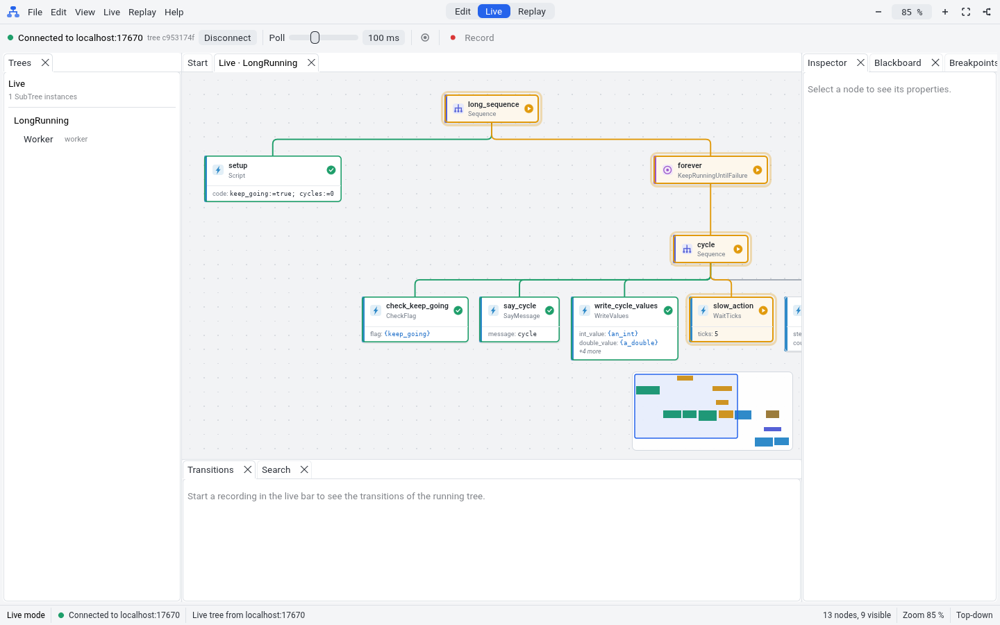

# Demo note M2: Live debugging

This note shows the result of milestone M2. FastTick connects to a running
BT.CPP 4 executor that has a publisher. It shows
the live status of each node, the blackboards and the breakpoints.

## What M2 gives

- A protocol client (`fasttick-protocol`) for all request types of the BT.CPP
  4.9.0 publisher: tree, status, blackboard, hooks (breakpoints and forced
  results), recording and transitions.
- A heartbeat. When FastTick disconnects or stops, the executor removes the
  hooks after its timeout, so a tree never stays blocked.
- Detection of a restart of the executor (a new tree). FastTick loads the
  new tree.
- In the GUI (live mode):
  - The connection bar: host, port, poll interval, connect and disconnect.
  - The live tree with a status colour on each node. The edges to running
    nodes have a colour too.
  - The blackboard panel: watched blackboards, a filter, and the value type.
  - Breakpoints before a node. When the tree stops at a breakpoint, a banner
    shows the node. **Continue**, **Force SUCCESS** and **Force FAILURE**
    release it.
  - Forced results ("fault injection"): a node does not tick and returns
    SUCCESS or FAILURE. The canvas marks these nodes.
  - Breakpoint files: save and load the breakpoints of a tree.
  - Recording: the transitions go to a `.btlog` file that replay mode opens.

## Try it

1. Build the test executor (see `test_harness/README.md`).
2. Run `fasttick_executor --xml test_harness/trees/long_running.xml --port 1667`.
3. Run `fasttick --mode live --connect localhost:1667`.
4. The canvas shows the tree. The running nodes have an orange colour.
5. Right-click the node `slow_action`. Select **Add breakpoint before the node**.
6. The tree stops before `slow_action`, and a banner shows the node.
7. Click **Continue** to release the node.
8. Click **Record** in the live bar. Wait 5 seconds.
9. Click **Stop recording** and save the `.btlog` file.

## Evidence

- `cargo test -p fasttick-protocol`: 125 tests. They include tests with the
  real BT.CPP executor for each request type, breakpoints, forced results,
  the heartbeat, recording and a restart of the executor. A fake server
  sends bad and old messages to the client.
- `cargo test -p fasttick-app --test ui_live`: headless UI tests with a
  fake publisher.

## Limits

- Breakpoints "after the node" are not available. BT.CPP 4.9.0 keeps a POST
  hook in the PRE slot, so the menu entry is disabled (plan decision D4).
- The blackboard panel shows the values that the executor sends. A type that
  the executor cannot convert to JSON shows its C++ type only.
