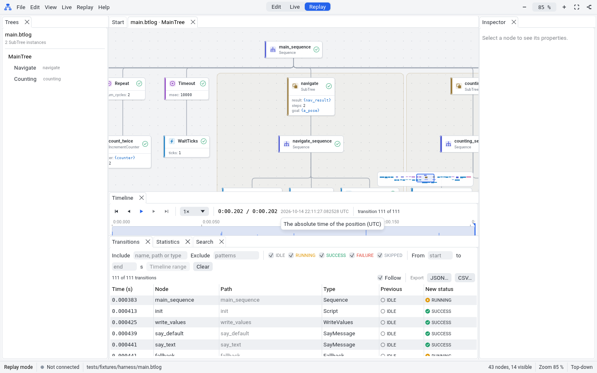

# Demo note M3: Replay

This note shows the result of milestone M3. FastTick opens the logs of
BT.CPP 4 and replays them on the canvas.

## What M3 gives

- A reader and a writer for `.btlog` files (`BT::FileLogger2`).
- A reader for SQLite logs (`BT::SqliteLogger`, `.db3` and `.btdb`). A file
  with more than one session shows a dialog to select the session.
- A replay index: the status of each node at each point in time, quickly,
  also for long logs.
- In the GUI (replay mode):
  - The timeline: play, pause, step to the previous or next transition, go
    to the start or the end, speed, scrub, and zoom to a time range.
  - The canvas shows the status of each node at the timeline position. An
    IDLE node shows its last status before the reset.
  - The transitions table: filters for node names, paths and types, status
    filters and a time range. Click a row to show the node.
  - Export of the filtered transitions to JSON or CSV.
  - The statistics table: for each node, the number of transitions, of
    SUCCESS, FAILURE and SKIPPED results, and the time in RUNNING.

## Try it

1. Run `fasttick tests/fixtures/harness/main.btlog`.
2. Click the play button on the timeline. The statuses on the canvas change.
3. Drag the timeline position back to the start.
4. In the transitions table, type `count` in the **Include** field. The table
   shows the transitions of the nodes `count_once` and `count_twice` only.
5. Click **CSV…** and save the file.
6. Open the **Statistics** tab. It shows the counts for each node.

## Evidence

- `cargo test -p fasttick-log`: 93 tests. They include logs that the real
  BT.CPP executor writes (`.btlog` and SQLite), round trips of the writer,
  the replay index, the statistics and the export.
- `cargo test -p fasttick-app --test ui_replay`: headless UI tests of the
  timeline, the transitions table and the export.

## Limits

- `BT::FileLogger2` can lose the last transitions when the executor stops.
  FastTick shows the transitions that are in the file.
- Logs do not contain blackboard values, so the blackboard panel is empty in
  replay mode.
